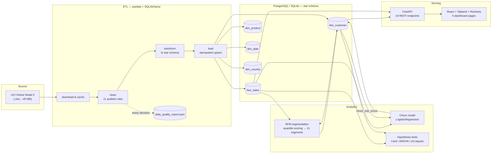

# Retail Sales & Customer Insights Platform

A full-stack business intelligence application over the UCI **Online Retail II**
dataset (~1.07M raw transaction lines from a UK online retailer, Dec 2009 – Dec 2011).
It answers the question a retail analyst actually gets asked: *which customers drive
the revenue, which of them are about to leave, and how much money is at stake?* The
platform loads the raw spreadsheets into a star-schema warehouse, scores every
customer with RFM segmentation and a leakage-free logistic-regression churn model,
and serves the results through a FastAPI backend to a React dashboard.

**Web demo:** [Deploy the full platform](#deployment).

---

## Table of contents

- [Retail Sales \& Customer Insights Platform](#retail-sales--customer-insights-platform)
  - [Table of contents](#table-of-contents)
  - [Architecture](#architecture)
  - [Screenshots](#screenshots)
  - [Tech stack](#tech-stack)
  - [Quick start](#quick-start)
    - [Docker (recommended)](#docker-recommended)
    - [Without Docker](#without-docker)
    - [Running pipeline stages individually](#running-pipeline-stages-individually)
  - [Key findings](#key-findings)
  - [API documentation](#api-documentation)
    - [Error contract](#error-contract)
  - [Data quality \& the ETL contract](#data-quality--the-etl-contract)
  - [The churn model](#the-churn-model)
  - [Testing](#testing)
  - [Deployment](#deployment)
    - [Backend + database — Render](#backend--database--render)
    - [Frontend — Vercel](#frontend--vercel)
  - [Project layout](#project-layout)
  - [License](#license)

---

## Architecture



**Why a star schema?** Every dashboard query is a `fact_sales` aggregation sliced by
one or two dimensions. Conforming the dimensions once at load time keeps those queries
to a single join each, and makes the grain explicit: **one row per invoice line**.

**Why the same code runs on SQLite and Postgres.** Every query is written through the
SQLAlchemy expression layer, never raw SQL strings. SQLite is the zero-install default
so a reviewer can clone and run the whole pipeline with no database server; Postgres is
the docker-compose and production target. Both are verified against the full dataset and
produce identical results — CI runs the test suite against each.

---

## Screenshots

> Capture these locally with `make setup` and drop them in `docs/screenshots/`.
> They are intentionally not committed: the images add several MB to a clone, and
> they go stale the moment a chart changes.

| Page | What it shows |
|---|---|
| Executive Overview | KPI cards with MoM deltas, revenue trend, revenue by country |
| Customer Segments | Segment treemap, sortable contribution table, drill-through |
| Churn Risk | At-risk table with threshold filter, ROC curve, confusion matrix, revenue at risk |
| Customer Detail | Purchase timeline, RFM breakdown, churn probability gauge |
| Statistical Insights | Hypothesis tests in plain language, with the supporting chart |

---

## Tech stack

| Layer | Choice |
|---|---|
| Database | PostgreSQL 16 (SQLite for zero-install local runs) |
| ORM / migrations | SQLAlchemy 2.0, Alembic |
| ETL | pandas, openpyxl |
| ML / stats | scikit-learn, SciPy, NumPy |
| API | FastAPI, Pydantic v2, Uvicorn |
| Frontend | React 18, TypeScript, Vite, Tailwind CSS, Recharts, lucide-react |
| Testing | pytest (174 tests) |
| Infra | Docker multi-stage builds, docker-compose, nginx, GitHub Actions |

---

## Quick start

### Docker (recommended)

```bash
git clone https://github.com/pratyush-015/retail-customer-platform.git retail-insights-platform
cd retail-insights-platform
cp .env.example .env          # defaults work as-is

make setup                    # or: docker compose up -d --build && docker compose run --rm seed
```

Then open:

- **Dashboard** — http://localhost:3000
- **API docs** — http://localhost:8000/docs

`make setup` downloads the dataset (~45 MB, cached in `data/raw/`), runs migrations,
loads ~1.03M fact rows, computes RFM, trains the churn model, and scores every
customer. Budget **8–12 minutes** on first run; subsequent runs reuse the cached file
and the load is idempotent.

### Without Docker

```bash
cp .env.example .env
pip install -r backend/requirements.txt
python scripts/seed_all.py                       # full pipeline against SQLite

cd backend && uvicorn app.main:app --reload      # terminal 1 → :8000
cd frontend && npm install && npm run dev        # terminal 2 → :5173
```

### Running pipeline stages individually

Each stage is independently runnable and re-runnable — useful when iterating.

```bash
python scripts/run_etl.py              # download → clean → load     (--force to reload)
python scripts/run_rfm.py              # RFM scoring                 (--dry-run to preview)
python scripts/train_churn_model.py    # train + write artifacts
python scripts/score_customers.py      # write churn_risk_score
python scripts/run_stats.py            # print all hypothesis tests
python scripts/verify_warehouse.py     # 10 integrity assertions
```

---

## Key findings

Numbers below are the live output of `verify_warehouse.py`, `run_rfm.py` and
`run_stats.py` against the full dataset — not illustrative placeholders.

**1. Revenue is extraordinarily concentrated.** Champions are 25.1% of customers but
**71.4% of net revenue** (£11.63M of £19.01M). Add Loyal Customers and just under half
the base accounts for 86% of revenue. The practical read: retention spend on the top
two segments has far more leverage than acquisition, and losing a single Champion costs
roughly what acquiring 30 one-off buyers earns back.

**2. £1.64M of historical revenue sits in lapsing segments.** 1,657 customers (27.9%)
fall into About To Sleep / At Risk / Cannot Lose Them / Hibernating. The *Cannot Lose
Them* group is the sharpest target — only 112 customers, but they averaged 8.0 orders
each before going quiet for ~491 days. High past value plus long silence is exactly the
profile where a win-back campaign pays for itself.

**3. Churn is predictable from behavioural rhythm, not raw spend.** The model reaches
**ROC-AUC 0.807** (5-fold CV 0.800 ± 0.014) on a 56.6% base rate. The dominant features
are `avg_days_between_orders` (odds ratio 2.06) and `recency_ratio` (1.94) — how overdue
a customer is *relative to their own habit*. Monetary value barely matters (OR 0.89).
A big spender who buys quarterly is fine at day 80; a weekly buyer silent for 30 days is
already in trouble. A single global recency cutoff would miss that entirely.

**4. Geography is statistically significant but practically weak.** Germany's AOV
(£538.68) beats the UK's (£471.92) at *p*=0.0026 — but Cohen's *d* is 0.06, and country
explains only 1.9% of AOV variance (ANOVA *F*=110.51). Country and churn are likewise
dependent (χ²=30.64, *p*<0.001) with Cramér's V of just 0.073. With ~40k orders even
trivial differences clear *p*<0.05, so the platform reports effect sizes alongside every
*p*-value and says so in plain language. **RFM segment vs. churn is the one genuinely
strong association** (χ²=4307.72, Cramér's V=0.851) — which is the reassuring result,
since it means the segmentation is capturing real retention behaviour rather than noise.

---

## API documentation

Interactive OpenAPI docs are auto-generated at **`/docs`** (Swagger UI) and **`/redoc`**.

| Method | Endpoint | Purpose |
|---|---|---|
| GET | `/api/health` | Liveness + DB and model-artifact status |
| GET | `/api/kpis/summary` | Revenue, orders, customers, AOV, MoM growth |
| GET | `/api/sales/trend?granularity=month\|week` | Revenue time series |
| GET | `/api/sales/by-country` | Revenue split by country |
| GET | `/api/customers/segments` | Segment distribution + revenue contribution |
| GET | `/api/customers/{customer_id}` | Profile, RFM, churn score, order history |
| GET | `/api/churn/at-risk?threshold=0.5` | At-risk customers + revenue at stake |
| GET | `/api/churn/model-performance` | Confusion matrix, ROC curve, feature importance |
| GET | `/api/stats/hypothesis-test?type=ttest\|anova\|chi2` | Run a test, get plain-language reading |
| POST | `/api/predict/churn` | Score arbitrary RFM values ad hoc |

### Error contract

Every failure — validation, domain, or unexpected — returns the same envelope:

```json
{ "error": { "code": "CUSTOMER_NOT_FOUND", "message": "Customer 99999 does not exist.", "status": 404 } }
```

Validation failures add a `details` array naming each offending field:

```json
{ "error": { "code": "VALIDATION_ERROR", "message": "Request validation failed.", "status": 422,
  "details": [{ "field": "threshold", "message": "Input should be less than or equal to 1", "type": "less_than_equal" }] } }
```

Domain exceptions (`CustomerNotFoundError`, `InvalidDateRangeError`,
`ModelNotLoadedError`, `DatabaseConnectionError`) each map to a specific status. Notably,
**a missing or corrupt model file yields 503 with an actionable message on the two
endpoints that need it — the other eight keep serving.** The registry validates the
artifact on load (`predict_proba` present, feature names matching metadata), so a
truncated `.joblib` is caught at startup rather than mid-request.

---

## Data quality & the ETL contract

Cleaning is **audited, not silent**. Every rule writes its row count and rationale to
`data/data_quality_report.json` (a committed sample lives in `data/sample/`), so any
number on the dashboard can be traced back to the rows behind it.

From the full run: **1,067,371 raw rows → 1,033,027 loaded** (96.8% retained).

| Rule | Rows | Decision |
|---|---|---|
| Exact duplicate lines | 34,335 | Dropped — same invoice/product/timestamp, an export artifact |
| Missing `CustomerID` | 243,007 | **Kept**, assigned to a sentinel. Real revenue; excluded from customer-level analytics only |
| Cancellations (`C`-prefixed) | 19,494 | **Kept**, flagged `is_cancelled`. Returns are signal, not noise |
| Non-product stock codes | 2,595 | Dropped — POSTAGE, BANK CHARGES, TEST, etc. are not merchandise |
| Zero/negative unit price | 6,202 | Dropped — adjustments with no economic meaning |

The two judgement calls worth flagging: dropping the 22.8% of rows without a customer ID
would understate total revenue by roughly a fifth, so they are retained for revenue
reporting and excluded from RFM. And cancellations are *netted* rather than removed — a
customer who returns everything is a materially different customer from one who never
bought, and the churn model's `return_rate` feature depends on that distinction.

Loading is idempotent via natural-key upsert: running the ETL twice yields identical row
counts, which `verify_warehouse.py` asserts along with referential integrity, revenue
arithmetic (`revenue == quantity * unit_price`), and calendar completeness.

---

## The churn model

**Churn definition:** no purchase in the 90 days *following* a fixed cutoff (2011-09-10).

The design decision that matters most here is **leakage prevention**. Features come only
from transactions *before* the cutoff; the label comes only from transactions *after* it.
Computing recency on the same window as the label would make the target a restatement of
a feature and produce a meaningless ROC-AUC near 1.00. 659 customers who first appeared
inside the observation window are excluded — with no pre-cutoff history there is nothing
honest to predict from.

| Metric | Value |
|---|---|
| ROC-AUC | 0.8065 |
| PR-AUC | 0.8269 |
| Precision / Recall / F1 | 0.788 / 0.745 / 0.766 |
| Accuracy (vs. 0.566 baseline) | 0.742 |
| Brier score | 0.179 |
| 5-fold CV ROC-AUC | 0.800 ± 0.014 |

10 features, `log1p` + `StandardScaler` inside the pipeline so inference can never
diverge from training. `class_weight="balanced"`, `random_state=42`. Artifacts are
`churn_model.joblib` plus a `model_metadata.json` carrying the training date, feature
list, hyperparameters, full metrics, ROC curve, and a threshold-sensitivity table the
dashboard reads directly.

The tight CV spread (±0.014) says the result is stable rather than a lucky split, and the
Brier score confirms the probabilities are usable as probabilities — which matters because
the UI lets you move the risk threshold and see precision/recall trade off in real time
(0.3 → 90% recall at 70% precision; 0.7 → 46% recall at 83% precision).

---

## Testing

```bash
make test           # or: cd backend && python -m pytest -v
```

**174 tests**, structured around the parts most likely to break silently:

- **ETL cleaning** — each rule in isolation, plus a deliberately malformed frame
  (nulls, wrong dtypes, negative prices, junk stock codes, duplicate rows) asserting the
  pipeline *logs and continues* rather than raising
- **RFM correctness** — a synthetic dataset with hand-computed expected scores, so a
  refactor that changes quantile edges fails loudly; includes the tie-heavy edge case
  where `qcut` cannot produce 5 distinct bins
- **Statistics** — tests against SciPy's own reference values, plus guards on the
  interpretation strings (a non-significant result must never read as significant)
- **Model registry** — missing file, corrupt file, and feature-mismatch paths all yield
  `ModelNotLoadedError` rather than a crash
- **API** — happy path and error path for all 10 endpoints, including the 422 body shape

CI runs the suite against **both SQLite and Postgres**, applies Alembic migrations to a
real Postgres instance, then lints, typechecks and builds the frontend.

---

## Deployment

### One URL for the full demo on Render

[](https://render.com/deploy?repo=https://github.com/pratyush-015/retail-customer-platform)

1. In the [Render dashboard](https://dashboard.render.com/), choose **New → Blueprint**
   and connect this repository, or use the button above. Choose the branch with the
   deployment changes. Apply the Blueprint and wait for the service to report **Live**.
2. Open the service's `https://<service>.onrender.com` URL. Open `/readyz` and confirm
   it reports `status: ok` for the warehouse and the churn model. Open `/docs` for
   Swagger. Test Overview, Segments, Churn, Customers, and Insights.
3. Copy the service URL into your README or interview notes. The free service sleeps
   between visits. Open it before presenting so it has time to wake up.

The image runs the full UCI pipeline during its build. The React dashboard, FastAPI,
SQLite star schema and fitted churn model ship together, so no separate database,
shell, or frontend configuration is required for the hosted demo. The web dashboard
is the React implementation. A Power BI report is not included in this repository.

To run exactly this image on your laptop:

```bash
docker build -f backend/Dockerfile -t retail-customer-platform .
docker run --rm -p 8000:8000 retail-customer-platform
```

Then open `http://localhost:8000`. To demonstrate **PostgreSQL**, use the seeded
Docker Compose setup in [Quick start](#quick-start).

### Optional split deployment

For a hosted PostgreSQL deployment, use a PostgreSQL service and seed it from a
Python environment with access to its connection URL. Set `DATABASE_URL` to that URL
in the seed environment and API service. From the repository root, run:

```bash
python scripts/seed_all.py
```

Keep the generated model and its metadata available to the API across restarts.
The hosted Docker image already includes a fitted model from the same UCI dataset
and default model settings. If you change the training settings, use the artifacts
from your seed run. Confirm `/readyz` returns HTTP 200 before sharing the dashboard.

For a separate Vercel frontend, import the repository and set **Root Directory**
to `frontend`. Set `VITE_API_URL` to your deployed API **origin** (for example
`https://retail-insights-api.onrender.com`) and redeploy. Add the Vercel origin
to `CORS_ORIGINS` on the API service.

---

## Project layout

```
retail-insights-platform/
├── backend/
│   ├── app/
│   │   ├── api/          # routers, one per resource
│   │   ├── core/         # config, exceptions, error handlers, db session, risk bands
│   │   ├── etl/          # download, clean, transform, load, quality report
│   │   ├── ml/           # features, train, score, registry, artifacts/
│   │   ├── models/       # SQLAlchemy star-schema models
│   │   ├── schemas/      # Pydantic request/response models
│   │   └── services/     # RFM, KPI, customer, statistics
│   ├── alembic/          # versioned migrations
│   └── tests/            # 174 pytest tests
├── frontend/src/
│   ├── api/              # typed client, query layer, generated types
│   ├── components/       # layout, error boundary, UI primitives, toasts
│   ├── hooks/            # useApi, useSortable, useDebouncedValue
│   └── pages/            # the five dashboard pages
├── scripts/              # seed_all.py + one runnable script per stage
├── data/                 # dataset cache + quality report (gitignored; sample committed)
├── docs/                 # phase handoffs, API contract dump
└── .github/workflows/    # CI
```

---

## License

MIT — see [LICENSE](LICENSE).

Dataset: [Online Retail II](https://archive.ics.uci.edu/dataset/502/online+retail+ii),
UCI Machine Learning Repository (CC BY 4.0).
